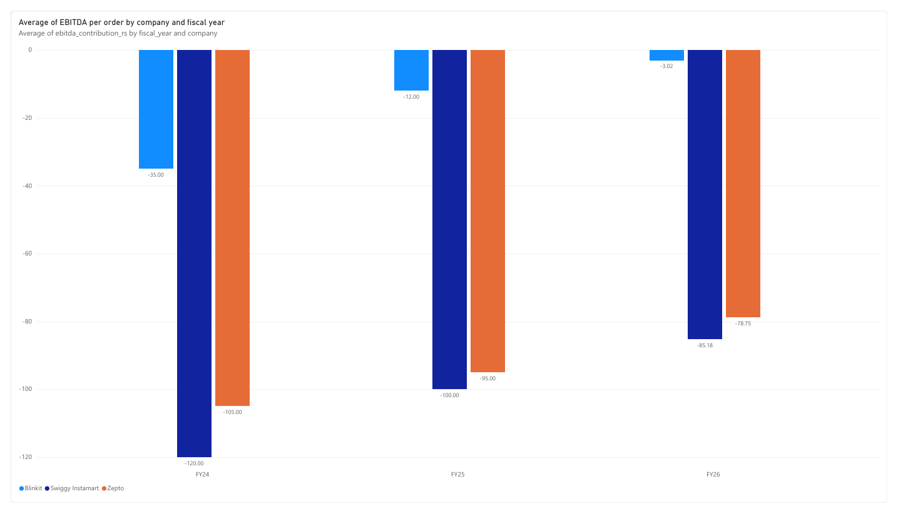
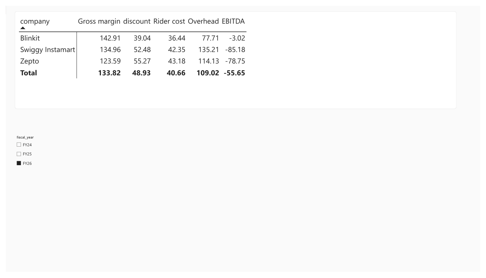
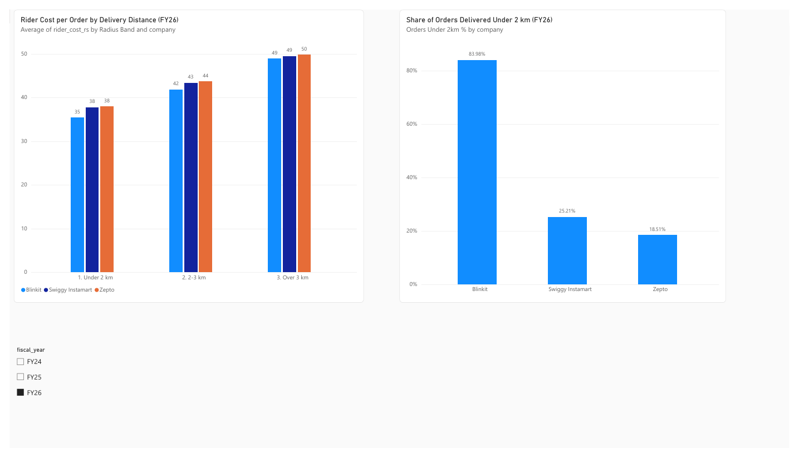
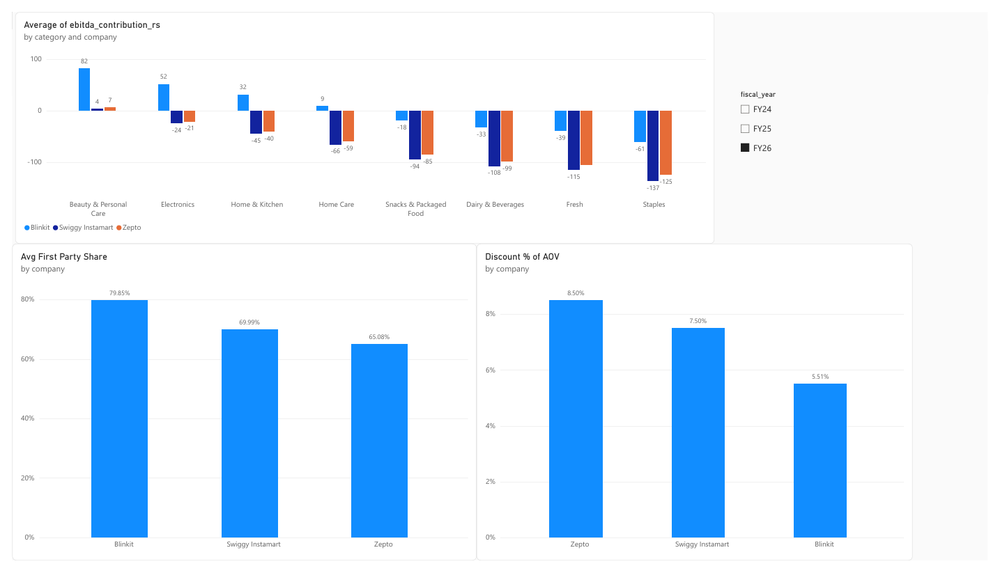
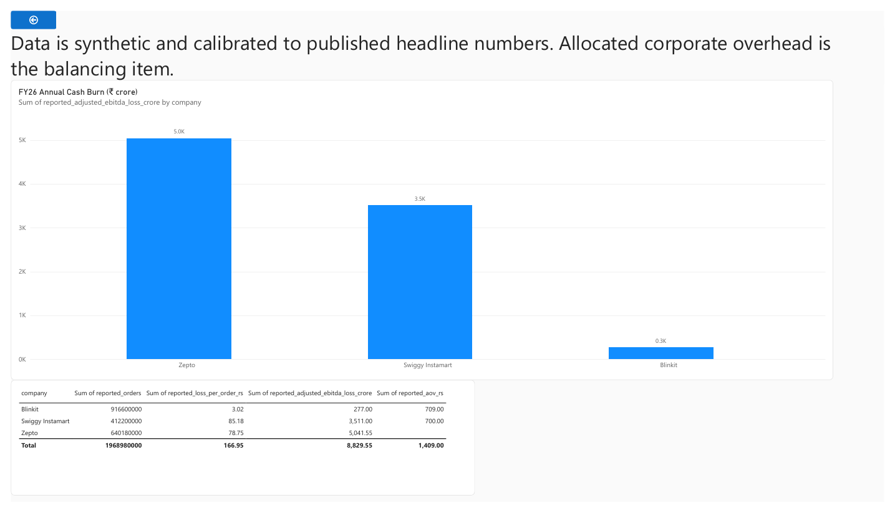

# Quick-Commerce Profitability: Blinkit vs Zepto vs Instamart

A business analysis of why Blinkit is closing in on break-even while Zepto and Instamart lose far more per order, built with Excel, PostgreSQL and Power BI.

## Business question
Which quick-commerce player has the healthiest unit economics, and what would it take for the others to catch up?

## Data
- 450,000 synthetic orders across FY24 to FY26 for Blinkit, Zepto and Instamart
- 15 data-quality checks run before any analysis
- Reported annual losses and AOV are included on the "Annual burn" page for comparison with the modelled numbers

The orders are synthetic. They were generated to reflect each company's publicly reported scale, so treat the results as a model, not as company disclosures.

## Key findings
| Finding | Result |
|---|---|
| EBITDA per order, Blinkit | improved from -Rs 35 to -Rs 3.02 |
| EBITDA per order, Zepto | -Rs 78.75 |
| EBITDA per order, Instamart | -Rs 85.18 |
| Discount as % of order value | Zepto 8.5% vs Blinkit 5.5% |
| Orders delivered within 2 km (FY26) | Blinkit 84% vs Zepto 19% |
| Value of closing half the discount and rider-cost gap | about Rs 735 Cr a year for Zepto |

## Dashboard (Power BI, 5 pages)
Open `QuickCommerce_Dashboard.pbix` in Power BI Desktop, or see the PDF export in `dashboard/QuickCommerce_Dashboard.pdf`. Use the fiscal-year slicer to switch years.

**1. EBITDA per order by company and year.** Blinkit improves from -Rs 35 (FY24) to -Rs 3.02 (FY26), while Zepto and Instamart stay deep in the red.

**2. FY26 per-order P&L.** Gross margin, discount, rider cost and allocated overhead by company.

**3. Delivery radius.** Rider cost climbs with distance, and 84% of Blinkit's FY26 orders ship under 2 km vs 25% for Instamart and 19% for Zepto.

**4. Discount, first-party share and category EBITDA.** Zepto discounts 8.5% of order value vs Blinkit's 5.5%.

**5. Annual burn.** Reported FY26 losses vs the modelled numbers. The page notes that the data is synthetic and calibrated to published headline numbers, with allocated corporate overhead as the balancing item.

## SQL
Two files in `sql/`:

**`quickcommerce_analysis.sql`** (Q0 to Q12, the main analysis):
- Q0: row counts, null checks and a P&L-to-EBITDA tie-out
- Q1-Q3: AOV, EBITDA per order, FY26 per-order P&L waterfall and the gap vs Blinkit
- Q4-Q9: delivery radius bands, category mix, discount intensity (`LAG`), first-party share, store quartiles (`NTILE`), city ranking (`RANK`)
- Q10-Q12: store density, benchmark reconciliation, and a what-if on annual burn if the discount gap is half closed

**`quickcommerce_extended.sql`** (E1 to E9, extra analysis):
- E1: contribution after rider per order with year-on-year change (`LAG`)
- E2-E3: data-quality checks: missing dark-store costs, and orders whose product category disagrees with `dim_product` (87%)
- E4-E5: Zepto and Instamart's discount and rider-cost gap to Blinkit, and impact sizing in Rs crore using a `JOIN` to the benchmark table
- E6: rider-cost penalty beyond 3 km
- E7: city league table (`RANK`)
- E8-E9: seasonality with a rolling 3-month average, and a January dip check

The extended queries use only columns that exist in the workbook, and were run on PostgreSQL 16 against all 450,000 orders. They reproduce the workbook's figures: Zepto's gap to Blinkit of Rs 16.24 in discount and Rs 6.74 in rider cost per order, the Rs 735 Cr and Rs 399 Cr uplift, the Rs 14.91 rider-cost penalty beyond 3 km, 198,607 missing dark-store costs, and a 29% January dip.

## Excel
`excel/README.md` documents the workbook behind this project: 26 tabs, 6 PivotTables (company and year, unit economics, category, city, top stores), a data-quality audit, 9 business problems with evidence, and recommendations with impact sizing (about Rs 735 Cr a year for Zepto). The 95 MB file itself is too large for a normal upload.

## DAX
`dax/measures.md` lists the Power BI measures with explanations: `Orders Under 2km %` (`CALCULATE` with `DIVIDE`), `Discount % of AOV`, `Avg First Party Share`, and a `Radius Band` calculated column.

## Tools
Excel (PivotTables, data-quality checks, findings), PostgreSQL (per-order unit economics queries), Power BI (dashboard, DAX).

## Author
Vartika Yadav | [LinkedIn](https://www.linkedin.com/in/vartika-yadav-b39a23314) | [Portfolio](https://tortootech.github.io/vartika/)
